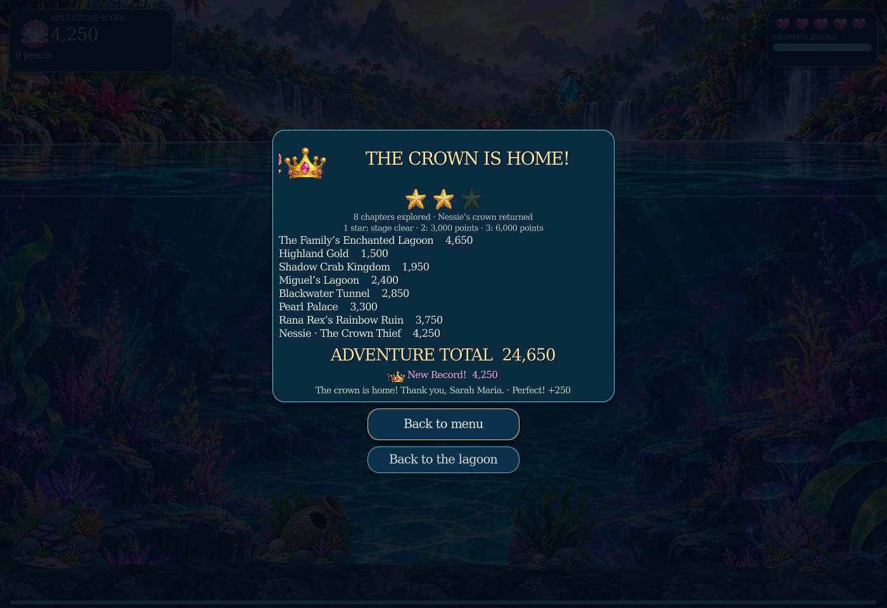
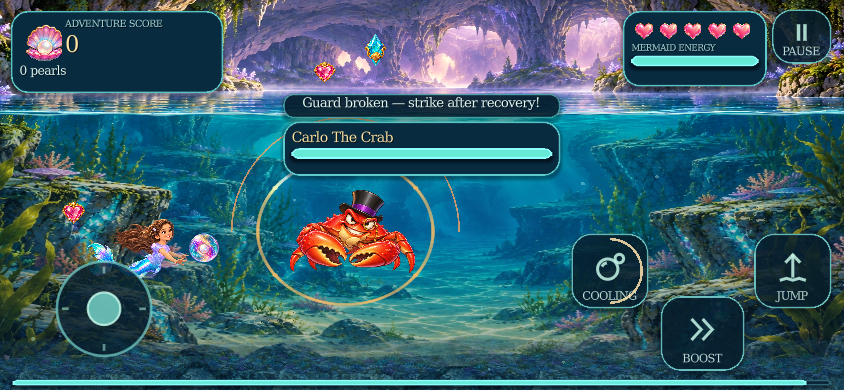

# v0.6.1 Adventure Polish

29 October 2026. Review follow-up to Opal Current commit `e580ffa3304ba8ede2ac1499c7f7dfb41b34e065`.

## Player-facing fixes

| Review finding | Implemented behaviour |
| --- | --- |
| Progress existed only in memory | Continue restores checkpoint score/award ownership, enemies, treasure, unlocks, Avina choice, shell switches and independent duo health. Tutorial lessons, gifts and peekaboo also resume. New adventures ask before replacing a checkpoint; chapter stars/bests remain. |
| Duplicate old projectile drawings | Basic chapters now use the shared Opal renderer exclusively for projectiles. |
| Charged cooldown ring used 0.20 seconds for every tier | Each bubble retains its actual recovery duration. Touch shows cooling and charge progress; keyboard/controller players get a discreet tier/progress card and a brief ready cue. |
| Boss fights hid important messages | Priority guard, damage, capacity and save feedback remains visible above the boss panel. Ordinary travel hints stay quiet during combat. |
| Help contradicted unlock/attack rules | Help explains both unlock paths and all charge thresholds. Boss introductions describe Bubble or Boost where both work. The family tutorial offers an optional Royal Aurora target with one reward and no exit gate. |
| Route progress used raw world coordinates | Each chapter measures its playable entry to its actual portal, including Nessie starting at zero and completing at 100%. |
| Finale showed only Nessie’s points | A crown-return results card presents the whole adventure total and chapter breakdown. Chapter personal bests/stars and a completed-journey record are distinct. |
| Emphasis followed enemy-array order | Four ordinary shells receive emphasis by attack/windup state and distance. Cooling enemies yield to immediate threats; the visual caps remain unchanged. |
| Settled HUD kept rebuilding | Finished score counting, result rows and modal layout stop updating; inactive floating feedback is skipped. |
| Later boss volleys repeated one pattern | Queen Antonella’s Crown Waltz, Rana’s Rainbow Ladder, Nessie’s Cresting Wake and Baron Bite’s Pincer Pearls have distinct geometry. Each has a 0.28-second locked-direction warning and at most three shots per existing volley. Speeds, health, recovery gates and projectile pools remain. |

## Saving and compatibility

Preferences keep their existing application identity and file. A separate versioned adventure file lives in Godot’s `user://` directory. Save writes use a verified temporary file, content checksum, atomic replacement and a last-good backup. Recovery never replaces a good backup with an incompatible primary. Object decoding is disabled. A strict floating-point comparison tolerance handles sub-pixel Godot JSON parser differences; the serialized file checksum remains exact.

Autosaves happen at checkpoints/lesson transitions, chapter clears and safe exits/focus loss, with unchanged states skipped. Serialization, verification, backup and file replacement run on a worker using an owned snapshot, without touching live scene data. There is at most one active write plus one coalesced newest request. Every task is joined, and explicit exits flush pending writes. Continue clears held input and transient attacks and supplies arrival protection. Chapter clears save the next chapter; completing Nessie retains records without offering a cleared campaign as Continue. Existing v0.6 preferences and best-score data are preserved. The project declares Godot 4.4 because native JSON conversion is used; verification uses Godot 4.4.1.

## Verification

The new `adventure_polish_test.gd` exercises real title Continue, checkpoint/duo/tutorial restoration, interrupted-file recovery, native value types, per-tier cooldowns, desktop/touch feedback, priority messages, route endpoints, final totals, settled HUD work and bounded/locked boss patterns. Existing native suites and fresh-package validation are rerun. Developer checks are excluded from the playable archive.

25 selected native suites passed, including **107 Adventure Polish checks**, **160 Opal combat checks**, the complete eight-chapter flow, device layouts and representative animation checks. Each suite receives a fresh user-data directory so saved Gentle Motion or Economy preferences cannot alter its inputs. A scene-flow test timed out under concurrent import/render load; its isolated rerun and the extracted-package copy both passed. The final native logs contain no engine errors or warnings.

Fresh extraction, import and main-scene startup passed, followed by **13 suites against the extracted project**. The playable archive has **205 files and 16 explicit directories**, passes CRC verification, and every file matches the source. Tests, captures, source art and historical reports are excluded.

An additional two-process audit wrote a real checkpoint, exited the engine, then used title-screen Continue in a new engine process. All eight assertions passed, retaining duo health, switches, score ownership, records, unlocks, Avina and damage history. One diagnostic write enqueued in **2.365 ms** and completed its serialization/verification/file work on the worker in **12.914 ms**; these are one probe, not a frame-rate guarantee.

**18 native full-quality captures** cover Continue/chapter records, all charge/cooling states, compact touch feedback, four signature attacks, optional super practice and desktop/phone finales. Desktop captures use 1400×960; phone captures use an 844×390 window. Results layout also has an on-screen-controls assertion. These are scripted native fixtures, not a human full-game playthrough.

All **118 existing files** under `dist/`, `godot/assets/` and `godot/animations/` are byte-identical to v0.6. Another **25 shader, rig and motion files** are unchanged. Rendering settings and full-quality defaults are retained; project settings change only the release version and minimum Godot feature version.

## Matched full-quality measurements

Baseline: `e580ffa3304ba8ede2ac1499c7f7dfb41b34e065`; runtime under test: `e8f6539fb1d394b7e1904cbbe86c703c095611a7`. Godot 4.4.1, Compatibility, Xvfb/llvmpipe, two llvmpipe threads, 1400×960, 30 warmup frames and 60 measured frames. Runs are sequential with other game tests and imports stopped. Both revisions use byte-identical normal and dense workload scripts and isolated user data. Dense cases keep eight friendly projectiles, 32 hostile projectiles, six foes and the existing impact interval.

Values below read **v0.6 → v0.6.1**. Update time measures the scripted update interval, including scheduling/native-call waits; it is not exclusive CPU profiling.

| Workload | Update median, ms | Rendered frame median, ms | Draw-call median |
| --- | ---: | ---: | ---: |
| highland-entry | 7.447 → 7.783 | 164.201 → 174.405 | 228 → 228 |
| waterfall | 9.102 → 6.776 | 196.790 → 123.846 | 43 → 43 |
| title | 6.389 → 6.034 | 170.948 → 190.198 | 162 → 162 |
| dense-highland | 8.573 → 7.158 | 178.358 → 176.998 | 197 → 201 |
| dense-shadow | 8.103 → 7.989 | 199.203 → 331.881 | 180 → 184 |
| dense-palace | 8.148 → 10.738 | 173.009 → 309.252 | 190 → 155 |
| dense-training | 7.636 → 9.287 | 184.136 → 261.831 | 214 → 174 |

The first dense run contained large later-area spikes, so those three workloads were rechecked in fresh processes, one area per process, with revision order reversed:

| Isolated dense workload | Update median, ms | Rendered frame median, ms | Draw-call median |
| --- | ---: | ---: | ---: |
| palace | 7.329 → 7.601 | 226.634 → 258.254 | 190 → 155 |
| shadow | 11.080 → 7.387 | 263.800 → 220.774 | 180 → 184 |
| training | 16.562 → 12.435 | 420.654 → 245.601 | 214 → 174 |

Palace removes 35 median draw calls and the tutorial removes 40 in both passes. Highland and Shadow add four for the desktop charge card. The four dense cases retain the same texture-memory readings in both revisions; peak monitored texture bytes are 297,124,833. Projectile and impact pool caps remain unchanged.

**These software timings do not establish a reliable FPS gain or uniform regression.** Large frame/p95 spikes occurred in both revisions, including the old build on isolated rechecks. The harness also freezes native particles/tweens while manually advancing game logic. Physical Windows/Android/iOS frame times and human boss-balance playtesting remain outstanding; quality settings have not been reduced to improve these numbers. Raw startup, frame, update, p95, texture and draw data, hashes and validation provenance are retained in [the machine-readable report](validation-adventure-polish.json).

## Native review views

Archive: `Mermaid-Adventure-v0.6.1-Adventure-Polish.zip` — SHA-256 `be64d0e13beadb2c929758a5b64502b3ecf93a36c8b9c1e326ff4eb2360978e8`.
