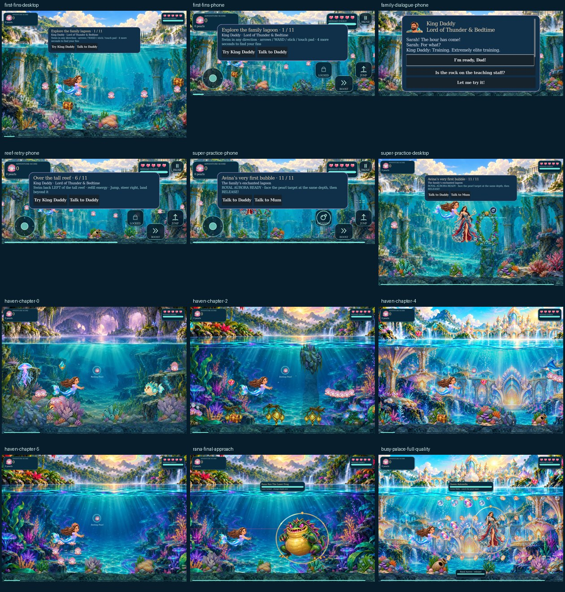

# v0.9.0 Journey Polish

29 October 2026. Follow-up to v0.8.0 (`e5f5301a7da73d7155697da8248aef6cf465f6c7`). This pass covers route continuity, travel pacing, first-session teaching and full-density effects. It preserves the Opal Current artwork, quality defaults, authored mesh detail, chapter content and attack limits.

## What changed

| Finding | Result |
| --- | --- |
| Rana stood at x17,954 in a 41,600-unit chapter, leaving 23,476 units to the portal after the fight | Rana now guards the clear final arena at x40,250, leaving a 1,180-unit exit. All existing formations, ordinary enemies and treasure remain. |
| Some long travel legs lacked a nearby retry point | Authored checkpoints remain. Long gaps gain quiet Resting Pearls, and long final approaches gain a pre-boss checkpoint. Planning runs once; one nearby haven at most is drawn, using the existing shell painting, mint ring and restrained glow. |
| Checkpoint hearts refilled but energy could remain empty | Every travel checkpoint now refreshes hearts and energy. Crossing multiple stops in a long frame creates one final snapshot and one feedback event. Existing stolen-loot release remains. |
| Retry discarded the already recovered checkpoint berth and forced y480 | Retry now returns to the saved, collision-recovered position. This also keeps Nessie’s retry at the intended berth. Save format and application identity remain compatible. |
| Family conversations required following a branch before returning to play | Every story conversation has a fixed visible “Let me try it!” footer, with the original branches still available. The companion farewell keeps its required choice/ending flow. |
| Touch release inside a conversation could leave an old movement vector active | Entering/leaving dialogue clears touch vectors and cancels held bubbles. Authored in-progress movement still pauses/resumes correctly. |
| Lessons did not respond clearly to common failed attempts | Prompts show lesson/ring/volunteer progress, energy recovery, tall-reef retry direction, gift state, real mint vulnerability and hit cooldown. |
| First bubble practice omitted exact timing and aim | Optional practice explains the 1.35-second hold and matching the target’s depth; it explicitly asks for release at Royal Aurora readiness. The exit remains optional and open. |
| Dense effects repeatedly resolved unchanged frame data and radial directions | Existing texture/material references, headings and extents are cached. Availability is queried once per effects sync; impact directions are computed once. Eight friendly shots, 32 hostile shots, 24 ordinary-foe slots and twelve impacts remain. |

## Whole-route checks

`journey_flow_test.gd` continuously steers through all seven campaign maps using touch input and the actual swimming/collision controller. It follows a collision-edge route graph, runs the real waterfall sequence, collects encountered rewards, retries all 44 crossed checkpoints, returns to each encounter and swims to the actual post-clear portal. It validates resources, safe saved berths, transient cleanup, results and 100% route progress. **334 checks pass over 39,960 native swim ticks.**

| Campaign chapter | Checkpoints retried |
| --- | ---: |
| Highland Gold | 10 |
| Shadow Crab Kingdom | 4 |
| Miguel’s Lagoon | 9 |
| Blackwater Tunnel | 2 |
| Pearl Palace | 9 |
| Rana Rex’s Rainbow Ruin | 10 |
| Nessie | 0 — already starts beside the boss |

This is scripted geometry/progression traversal. Boss defeat is explicitly staged only after reaching the encounter, and enemy AI is not advanced under the traversal fixture. Actual damage, charge, boss recovery, warnings and encounter transitions are covered by the Opal/Bubble/Boss suites; the Family Tutorial suite covers the opening’s required actions. This is **not a human opening-to-finale playthrough**.

`opening_journey_test.gd` adds **31 checks** for the responsive prompts, failed/successful jumps, charge threshold, optional exit, dialogue input cancellation and fixed-footer behavior. The footer is tested at desktop 1400×960 and phone 844×390, including scrolling and a minimum 44-pixel touch target. Worst lesson hints also fit 640×360.

`journey_effects_test.gd` adds **21 checks** for full projectile counts, painted heading/extent, unchanged full/Gentle Motion droplet positions, bounded impact recycling and transition cleanup. The effects comparison audit compares all eight chapters against the frozen v0.8 renderer, including texture paths, mesh geometry fingerprints, materials and every pooled child’s transform/visibility. Its raw results accompany this review.

## Visual and performance review

Native full-quality views cover the opening, phone dialogue/retry/super prompts, travel havens, Rana’s final arena and a dense palace encounter. These are deterministic fixtures at desktop and phone window sizes. The captured review retains the original paintings, water, lighting and character detail.

The paired stress workload retains eight friendly and 32 hostile shots, six foes and normal authored effects. Separate effects sampling additionally fills all twelve impact slots. Godot 4.4.1, Compatibility and llvmpipe software rendering are used; raw timings, draw counts, memory readings, hashes and provenance are in [validation-journey-polish.json](validation-journey-polish.json). Shared-host software timings do not establish hardware FPS or a uniform speedup. No visual setting, texture, geometry or effect capacity was reduced to improve them.

Fresh extraction/import/startup and the integrated test results are recorded in that machine-readable report. Tests, audits and capture images are excluded from the playable ZIP.

## Larger remaining work

- A human full-adventure balance pass should assess fun, teaching and recovery under actual enemy pressure, including controller and touch comfort.
- Physical Windows/Android/iOS frame-time measurements are still needed. The software renderer cannot certify smoothness on a phone.
- Some stretched chapters still allow 75–100 seconds of direct swimming. Distinct optional exploration activities, environmental interactions and small chapter objectives would give them richer pacing. This update keeps all existing content and adds rest/retry structure; it does not claim a redesigned campaign.
- Blackwater has no ordinary enemies in its authored source. Its light-and-obstacle passage remains a quiet contrast before Baron Bite; atmospheric tension should be judged in the human playtest before adding combat.

## Measured effects work

A matched in-process sample alternates baseline/current order for each frame, with 30 warmup and 120 measured updates per chapter. These are effects-component medians, not whole-game frame rates.

| Chapter | v0.8 effects, ms | v0.9 effects, ms |
| --- | ---: | ---: |
| Highland | 0.535 | 0.443 |
| Shadow | 0.501 | 0.413 |
| Miguel | 0.520 | 0.400 |
| Blackwater | 0.493 | 0.396 |
| Palace | 0.476 | 0.390 |
| Rana | 0.497 | 0.418 |
| Nessie | 0.470 | 0.419 |
| Training | 0.545 | 0.402 |

The medians fell 10.9–26.2% in this sample. There were **1,200 matched visual states and zero differences**, including all 96 droplets in twelve maximum-tier impacts. Cached sine/cosine directions remove up to 96 repeated trigonometric pairs per impact update.

Four sequential full-game stress cases have mixed CPU/frame timings and large shared-host spikes. New resting-pearl presentation adds six median draw calls in the sampled Highland and Palace views; Shadow and training counts remain the same. All four retain identical monitored texture memory and 8/32 projectile counts. These results do not establish a reliable whole-game FPS gain or regression; physical-device checks remain open.

## Final release validation

**18 native suites and 18 fresh-package suites passed**, including 334 route checks, 31 opening checks, 21 effects checks, 70 boss checks, 160 Opal checks and the complete eight-chapter continuation flow. The final package was freshly extracted/imported and the main scene started without engine errors. Twelve full-quality native views were reviewed, including the corrected fixed phone dialogue footer.

All **140 retained art, animation and shader files** match v0.8 byte-for-byte. All **207 ZIP files** match source, with 16 explicit directories and a clean CRC check.

Archive: `Mermaid-Adventure-v0.9.0-Journey-Polish.zip` — SHA-256 `ed0df99b1d772d4d22b6dd0b4a80b02e8cde3fb5af06a20db01f90aee7455b0f`.
