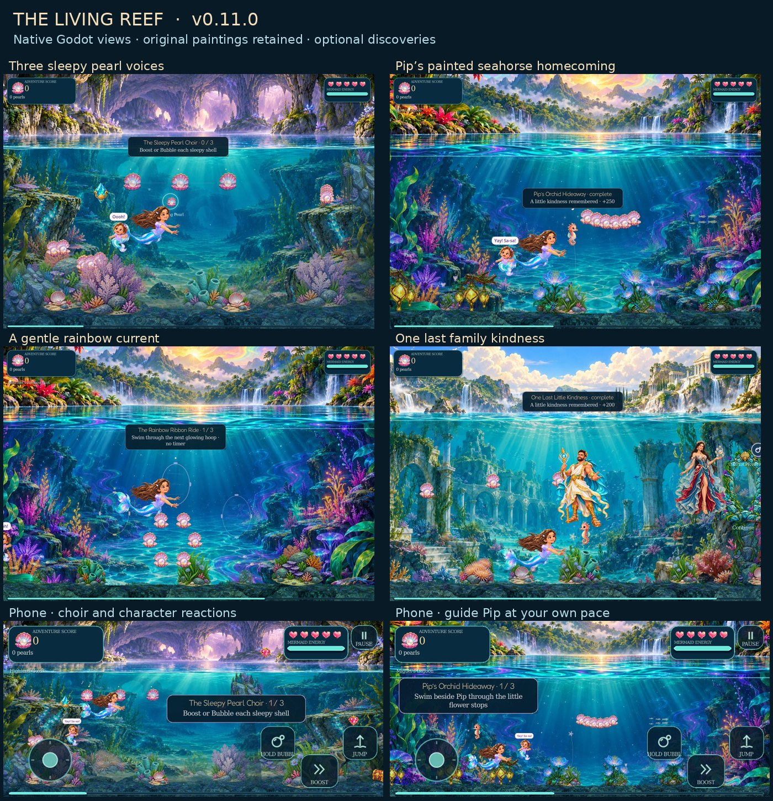

# v0.11.0 Living Reef

One optional encounter per chapter gives the Whimsy ocean little things to do together. Existing scenery, required lessons, boss rules and portal conditions remain in place.

## How to play

- **Shell choir:** wake all three shells with Boost or Sarah’s Bubble, in any order. Highland’s first choir comes after the waterfall and works with Boost before Bubble is unlocked. Each accepted shell adds a note. Rocks still block bubbles; Avina’s bubbles leave the task to Sarah.
- **Guide Pip:** swim beside the pearl seahorse through three flower stops, then home. Pip waits when Sarah swims away. There is no failure timer or escort damage. The family’s journey leads left, away from its open exit.
- **Current trail:** swim through three hoops in sequence. A gentle current assists only while Sarah chooses to swim along the path. It does not pull an idle player, oppose retreat, or modify Boost or jump. Boost is optional; there is no failure timer.

| Chapter | Discovery | Activity | Secrets points |
| --- | --- | --- | ---: |
| Highland Gold | The Sleepy Pearl Choir | Shell choir | 250 |
| Shadow Crab Kingdom | The Lantern-Shell Chorus | Shell choir | 250 |
| Miguel’s Lagoon | Pip’s Orchid Hideaway | Guide Pip | 250 |
| Blackwater Tunnel | The Lantern Current | Current trail | 225 |
| Pearl Palace | The Pearl-Chime Waltz | Shell choir | 275 |
| Rana’s Rainbow Ruin | The Rainbow Ribbon Ride | Current trail | 250 |
| Nessie | Pip’s Crown Homecoming | Guide Pip | 250 |
| Family Lagoon | One Last Little Kindness | Guide Pip | 200 |

Nessie’s encounter appears after the fight. The family’s appears at lesson 10, after the required trial and peekaboo. Activities pause progress during nearby active combat and stay inactive during waterfall travel, loading or pause. Skipping one never closes a portal or adds a required lesson.

## Character reactions and accessibility

Sarah eases her look toward a nearby discovery, smiles and uses an existing greeting or reward gesture. Avina can add a short baby acknowledgement when she is visible and travelling with Sarah. These expressions never request attacks or change gameplay state, and existing family speech keeps priority.

Boost, jump, charge, cast, impact and victory performance remain protected. Completion can wait in one bounded slot for up to two seconds for an action to finish, then expires quietly. Pause, retry, loading and combat clear optional reactions. Normal gaze expiry returns smoothly to swimming.

Gentle Motion keeps the activities and rewards, freezes additional ornament motion and uses a quiet painted smile instead of extra gaze movement or waving. Economy omits secondary visual detail while keeping the same mechanics.

## Checkpoints

Existing checkpoint snapshots now include discovery state, activation flags, progress and Pip’s position. Retry restores that saved partial progress with the score ledger. Completion marks the activity first, awards its stable ID once under Secrets, and banks completion and reward together at a nearby safe checkpoint. Repeating it cannot farm points. Completion itself does not refill health or energy.

Validation rejects malformed/nonfinite state and completion without the owned ledger reward. Older checkpoints can omit the new field. Existing save workers, backups, application identity and chapter records remain.

## Authoring and validation

`living_reef_data.gd` holds eight profiles and their copy. Each has three stops within 900 world units. Positions recover against the reef with 72-unit clearance; paths require 34-unit clearance, exceeding Pip’s 22-unit collision margin. Pre-boss encounters stay outside activation areas.

`living_reef.gd` owns progress, swept choir hits, current assistance and rewards. `living_reef_art.gd` reads its snapshot, reuses the Whimsy brush and shell/garden paintings, and adds [painted Pip](assets/living-reef/README.md). Lilac/gold hoops differ from mint hit-opportunity shells. Non-interactive captions scale for phones. Pip’s texture loads at scene setup. No enemy, projectile, impact or audio-player pool is added; notes reuse existing voices. These implementation limits are not a hardware FPS claim.

`living_reef_test.gd` checks all eight activities, actual guide/current swimming, any-order choir hits, Sarah/Avina ownership, wall priority, completion banking, partial rollback, old/malformed saves and pause/Gentle Motion. Its fixtures remove enemy pressure, so it is not a human balance playthrough. `living_reef_reactions_test.gd` checks gaze, facing, painted registration, action priority, bounded delay, cleanup, Gentle Motion and Avina’s speech/action limits.

Both new suites are registered in the fresh-package runner: **21 suites**, up from 19. Record actual release results and desktop/phone views alongside this guide. Physical-device frame times and a human full-adventure balance pass remain separate checks.

## Release checks — 30 October 2026

**22 native suites and 21 suites in a freshly extracted/imported package pass.** These include 170 Living Reef checks, 44 character-reaction checks, 1,640 real activity swim ticks, the 334-check full-route suite, 160 Opal checks and 14,584 face-detail checks. The new save checks exercise the real worker, disk reload, title-screen Continue, safe restore and one-time reward ownership.

Reviewed 34 distinct native views across all eight chapters, partial/completed encounters, phone layouts, Gentle Motion, pause and combat quieting. Compact measured captions avoid the activity, Sarah and the royal teachers. All **140 retained art, animation, shader, font, audio and atlas files are byte-identical** to v0.10. The new Pip WebP retains every RGBA byte of its generated PNG.

The native art-only probe passes **807 checks**. It measures 4–6 additional draw calls in the three representative activity scenes; offscreen activities add no draw calls or mesh uploads. There is no node/resource growth, buffer overflow or texture reload on approach. One fixed 12,288-vertex surface is reused.

| Activity | Added draws | Peak vertices | Build/upload block medians |
| --- | ---: | ---: | ---: |
| Choir | 5 | 1,830 | 0.385–0.460 ms |
| Guide | 6 | 3,714 | 0.694–0.778 ms |
| Current | 4 | 3,390 | 0.736–1.130 ms |

These are shared-host llvmpipe component samples with concurrent headless checks, not physical-device FPS. Raw texture counters also reflect font caches; added artwork has a real memory cost. The original full-quality settings and paintings were retained.

The playable ZIP has **214 source-matching files, 17 explicit directories and valid CRCs**. SHA-256: `09c70971829b6eb4a2fba5842bff1b99cd498ac8810ebe24f8de5509edb8d87f`. Tests, review captures and historical reports stay out of the playable package.

[Full checks and measurements](validation-living-reef.json) · [Pip provenance](assets/living-reef/README.md)

