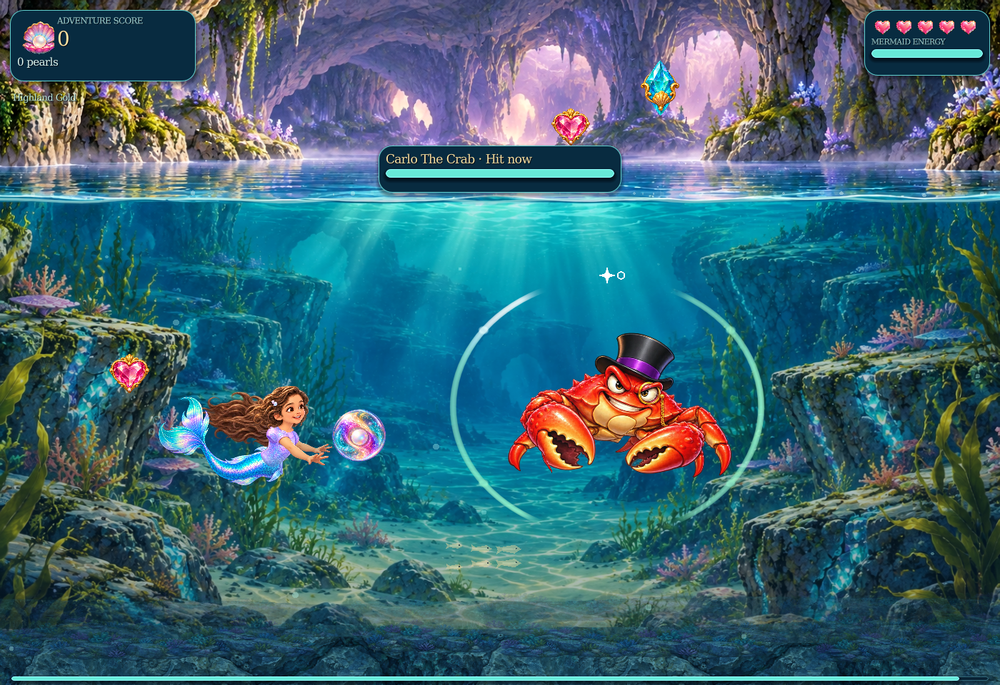

# v0.6 Opal Current

29 October 2026. Built on the v0.5.1 performance commit `087a0d9c04dc4d5bc0a3b84c9d4a31875da6c79b`. The update is stacked on performance PR #1, which remains unmerged.

Sarah forms a bubble while Bubble is held and fires once on release. Painted opal effects replace the circle projectiles, and every enemy/boss receives a fitted opportunity shell. The original high-resolution character paintings, articulated performances, environments, water, lighting and audio remain.

| Bubble | Hold | Ordinary damage | Boss damage | Recovery |
| --- | --- | ---: | ---: | ---: |
| Pearl Pop | Below 0.35 s | 1 | 1 | 0.20 s |
| Prism Bloom | 0.35 to below 1.35 s | 2 | 1 | 0.35 s |
| Royal Aurora | At least 1.35 s | 3 | 2 maximum | 0.65 s |
| Avina Little Pearl | Existing companion request/timer | 1 | 0 | Existing 2.8 s |

The Bubble controls remain B/Z, controller X and touch Bubble, with horizontal facing aim. Full charge stays held until released. Swimming remains responsive; boost/jump cancel charge. Readiness gets one soft chime and a small haptic cue. Touch labels show hold, charging and release readiness. Pause, focus loss, portrait, touch cancellation, controller disconnect, dialogue, choice screens, scene changes, death/retry, waterfall and unlock loss cancel without a shot. One physical source owns a hold, and cancelled sources must return to neutral before rearming. Reconnecting with a button held cannot start a charge.

## Combat and readability

Mint separated petals, a white star and the available-attack glyph indicate a real damage opportunity. Amber facets and a shield mean guarded; opening anticipation stays amber. Lavender broken arcs mean hit cooldown. Transparent centres keep faces and costumes clear. Normal foes remain hittable during their own attacks. Crowds use a few emphatic shells and quieter accents for other visible foes.

The same live chapter snapshots drive collision permission and shell state. Duke and Flip keep separate bodies, HP and open states with their existing shared cooldown: Flip remains independently damageable while Duke is guarded. The comedy stun and surviving-partner finish rule remain. Sarah's unlocked bubbles reach native/basic/Miguel boss adapters; Carlo stays boost-only before Bubble is unlocked, and Daddy's lesson-eight trial remains boost-only. Friendly royal teachers, playable Daddy, inactive/defeated bosses and Avina remain protected. Boost-only invitations account for energy and jump state. During Daddy's trial, his painting and shell now share the exact live combat position.

Swept paths resolve the earliest rock, switch, enemy or boss, with deterministic ties and consume-before-callback transactions. Native bubbles reduce actual enemy HP. Guard side follows the incoming hit direction; guards break into recovery without HP damage. Retry epochs and a bounded retired-packet ledger prevent stale/double hits. Score, loot, switch and clear callbacks retain their authoritative ledgers. Avina cannot damage any boss, including the duo.

The measured casting hand is 114 world pixels ahead of Sarah's root. Bubble centres add their visual radius, leaving her face and fingers clear. The first flight sweep includes the old 70-pixel launch segment, preventing the forward socket from skipping a nearby wall/target. Flight stays at 700 px/s with the existing footprint and lifetime. Super art adds damage through the explicit packet, with no extra piercing or area damage.

All delivery modes follow existing combat events. Crab/eel/swordfish/shark, ribbon ambusher, otter and Flip use attached melee wakes. Existing puffer/jelly/Journey fire events keep their cadence, origin, geometry, trajectory and warning lock. Drumback's current lane and theft/loot mechanics remain. Rana's laser retains its locked-y band; its ring and Nessie's pulse remain decorative. Daddy retains lightning, Concern Cloud, Wobble Wave, dash and Beard Blast.

## Art and performance design

Five retained production master sheets refine the Opal Current concept pack into 28 effects: four friendly bubbles, twelve species materials and twelve boss/special motifs. Provenance and source hashes are retained in `art-source/opal-current`. The developer export tool measures alpha islands and neighbouring ownership, retains source bounds/pivots/headings, and packs straight-alpha sprites with 16-pixel gutters. Authoring density is 256 px for shots, 384 px for the super/fields and 192 px for Avina. Original game art is never resized.

Ten atlases separate friendly effects, the six core species, the six lagoon species and chapter boss effects. Each scene declares its own textures for threaded loading; only its six species remain resident. Raw new RGBA8 storage is 3.06–5.12 MiB per chapter. The ten production PNGs match the previously validated exports byte for byte. Source masters are excluded from the playable archive and editor scanning.

Fixed visual pools contain eight friendly/32 hostile sprites, one charge preview, 24 ordinary/two boss shells, four fields and twelve impact crowns with at most eight droplets. Shared immutable annulus meshes, material variants and glass clasps keep costs bounded. Inactive slots and offscreen shells are skipped. Unlit effect surfaces also use a zero light mask; the dense Palace comparison removes four redundant draws with zero changed image channels. Collision caches expanded obstacle rectangles and rejects disjoint bounds before precise sweeps. Existing indexed surfaces, caches, sampling, all sixteen clips and eighteen aerial variations remain. The game retains its dimensional painted Compatibility renderer and existing sparse view resources.

## Reproduction

- `tools/run_regressions.py --godot <path> --output <directory>` runs every native suite and fails on engine errors, including zero-exit script errors.
- `opal_current_test.gd` tests live input ownership/cancellation, charge thresholds, pool admission, sweeps/ties, guards, score/loot, every boss window, independent duo state, tutorial protection and retry epochs.
- `tools/opal_visual_audit.gd` captures every chapter in guarded/opening/open/cooldown states, all twelve families, both Sarah facings, three charge tiers/release, maximum density, fields, protected roles, portrait cancellation and alpha on light/dark backgrounds.
- The unchanged `tools/performance_audit.gd` compares normal routes; `tools/opal_stress_audit.gd` runs the same dense workload against either revision. Use matched hardware/quality, execute sequentially and retain median/p95, draw, texture/object and startup results.
- `package_validation.py --godot <path>` checks CRC, explicit directories, Godot extraction, byte equality, fresh import/title startup and twelve fresh-extraction suites.
- `tools/build_opal_atlases.py` rebuilds exports from retained masters using Pillow, NumPy and SciPy; these are developer dependencies only.

The separate application version and menu footer identify v0.6. The application identity string stays stable to retain the existing Godot user-data/save location. Physical target-device GPU/FPS and human charge/boss-balance playtesting require target-device review.

Fresh validation exposed two native Godot 4.4.1 importer crashes with parallel imports enabled (one allocator abort and one segmentation fault during the original font import). Offline editor imports now run serially; runtime threaded scene loading, artwork and rendering settings are unchanged. This avoids concurrent offline importer work without reducing in-game quality. The [upstream font-import crash report](https://github.com/godotengine/godot/issues/111039) describes a similar concurrency failure; the exact native cause of these two local crashes was not established.

## Measured verification

**37/37 native suites pass, including 160 Opal combat/input checks.** The unchanged performance integrity suite passes 59,024 checks; all original detailed geometry, movement, controls, progression, score, tutorial and device-layout reviews pass. The playable package passes CRC, exact Godot extraction, fresh import/title startup and twelve fresh-extraction suites. Forty-eight native captures cover every family, every boss state, charge/release in both directions, density, protected roles, fields, portrait and light/dark alpha. All 107 existing art/audio/animation files are byte-identical; all ten production atlas PNGs retain their verified bytes.

The following runs use Godot 4.4.1 on Linux X11 with full quality at 1400 × 960 and two llvmpipe software-renderer threads. Each case warms for 30 frames and measures 60 frames at a manually advanced 1/60-second simulation step. Economy and Gentle Motion are off. Runs execute sequentially after other validation finishes. Full startup, median/p95, objects, draw and texture records are retained in `validation-opal-current.json`.

| Scene | CPU median / p95, ms: v0.5.1 → Opal | Frame median / p95, ms: v0.5.1 → Opal | Median draw calls | Added reported textures, MiB |
| --- | ---: | ---: | ---: | ---: |
| Duke and Flip | 6.275 / 10.826 → 7.435 / 11.093 | 183.913 / 213.559 → 204.473 / 283.977 | 182 → 185 | 4.84 |
| Miguel | 6.941 / 16.194 → 7.128 / 12.563 | 169.748 / 220.170 → 180.565 / 276.309 | 121 → 113 | 4.61 |
| Blackwater | 6.437 / 10.071 → 6.570 / 17.421 | 156.526 / 237.168 → 244.223 / 386.242 | 119 → 116 | 4.08 |
| Queen | 6.739 / 18.928 → 7.144 / 22.945 | 155.230 / 218.653 → 195.723 / 295.589 | 127 → 124 | 4.41 |
| Rana | 6.944 / 13.645 → 7.950 / 34.075 | 178.406 / 314.385 → 185.658 / 298.811 | 118 → 118 | 5.55 |
| Nessie | 7.155 / 14.816 → 7.429 / 10.590 | 155.208 / 183.474 → 169.183 / 222.019 | 115 → 112 | 4.46 |
| Family lagoon | 7.578 / 14.145 → 8.211 / 33.680 | 163.301 / 221.103 → 224.896 / 367.221 | 127 → 127 | 6.82 |
| Carlo arena | 6.507 / 9.245 → 7.542 / 14.257 | 152.949 / 181.954 → 163.327 / 215.327 | 155 → 153 | 4.42 |
| Highland entry | 6.637 / 9.411 → 7.308 / 14.274 | 157.064 / 175.855 → 163.120 / 179.929 | 225 → 228 | 4.42 |
| Title | 6.518 / 10.314 → 6.397 / 34.143 | 193.233 / 225.329 → 260.700 / 5046.652 | 162 → 162 | 0.00 |
| Waterfall | 5.903 / 8.615 → 6.605 / 17.567 | 117.959 / 132.726 → 128.065 / 195.789 | 43 → 43 | 4.42 |

The dense cases hold eight friendly and 32 hostile projectiles, six live enemies, a held super outside the boost-only tutorial, and periodic super impacts. Pool seeding is excluded from CPU timing.

| Dense case | CPU median / p95, ms: v0.5.1 → Opal | Frame median / p95, ms: v0.5.1 → Opal | Median draw calls |
| --- | ---: | ---: | ---: |
| Highland | 7.131 / 9.958 → 9.381 / 35.915 | 181.714 / 241.545 → 214.325 / 300.263 | 256 → 197 |
| Palace | 7.126 / 13.373 → 8.619 / 13.075 | 179.392 / 282.291 → 203.079 / 252.615 | 169 → 190 |
| Shadow | 7.242 / 10.880 → 7.058 / 9.494 | 203.286 / 253.458 → 190.595 / 254.002 | 242 → 180 |
| Training | 7.422 / 14.167 → 9.025 / 25.283 | 258.722 / 284.890 → 215.371 / 356.926 | 196 → 214 |

The aggregate of ordinary CPU medians changes **+8.3%** (mean **+0.553 ms** per case), and software frame medians change **+18.9%**. Dense CPU medians change **+17.8%** (mean **+1.290 ms** per case); draw-call medians change **-9.5%**, and software frame medians change **+0.0%**. These are controlled software-renderer observations, with host scheduling variation. The CPU timer includes new sprite synchronization while the old immediate draw callbacks run outside that timer. They disclose feature cost and do not establish hardware FPS.

Dense first-frame and warm-up maximum/p95 timings are retained separately, including initial shader/texture work. Startup values distinguish the first scene from subsequent loads within each process and do not represent a flushed disk cache. Native particles/tweens are frozen for repeatability; new charge and impact geometry remains active. Physical target-device GPU/FPS, long play sessions and human charge/boss-balance testing remain outstanding.

No source artwork, animation detail, resolution, lighting or original effects were reduced. Chapter-local species loading keeps raw new art at 3.06–5.12 MiB; reported additions including renderer accounting remain below the proposed 8 MiB ordinary /16 MiB duo budgets.

[Native Nessie scene before the update](device-qa/opal-current/nessie-before.png) · [Native Nessie scene after the update](device-qa/opal-current/nessie-after.png). These captures use the same audit script, camera, resolution and fixed simulation schedule.

The ordinary-route tour above was measured immediately before the final zero-light-mask optimisation; the dense tour includes it. The separate Palace comparison verifies four fewer draws and zero changed image channels. Offline imports use the final serial-import setting and pass on unrestricted CPU affinity.
