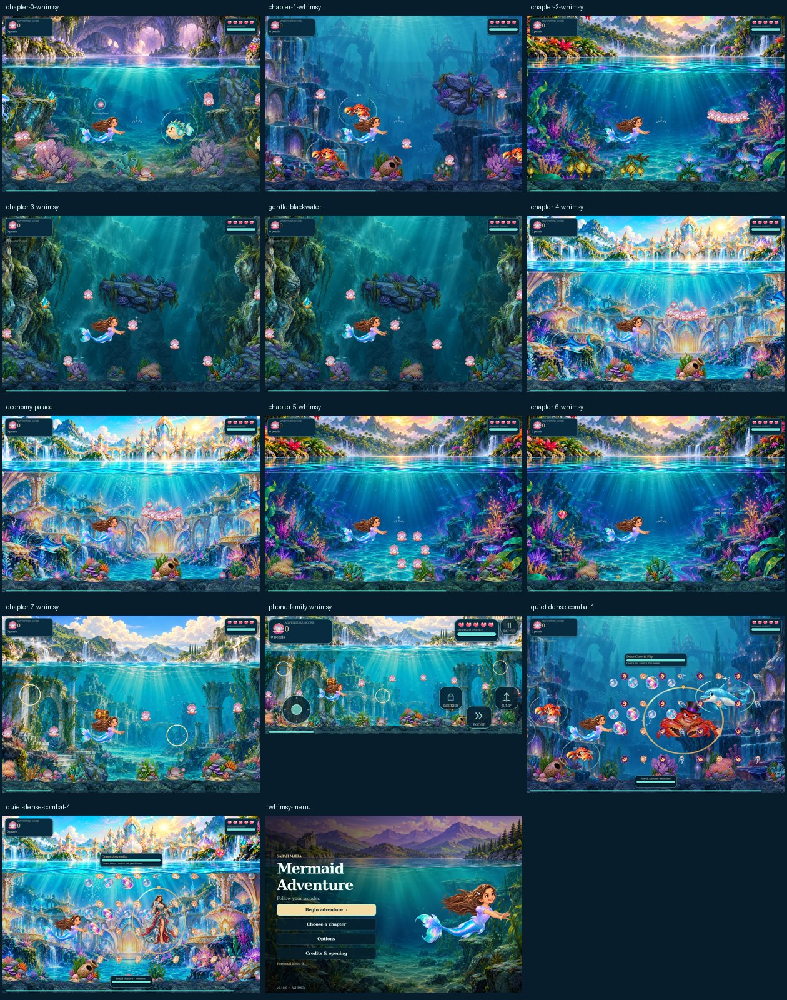

# v0.10.0 — Whimsy

30 October 2026. A decorative follow-up to Journey Polish on main (`36d2ae9eb7b8708842be4d1c75c7c07f51c3d7c4`). The original painted scenery, Sarah’s rig and animation detail, combat, movement, chapter content and save rules are retained.

## Little ocean discoveries

| Chapter | New touches |
| --- | --- |
| Highland Gold | Painted clam gardens with warm pearl glows and slowly wandering wisps. |
| Shadow Crab Kingdom | Swaying seed lanterns with soft lights amongst the existing reef. |
| Miguel’s Lagoon | Small orchid-like sea butterflies, with paired fluttering wings. |
| Blackwater Tunnel | Tiny bioluminescent coral tips and drifting satin glints. |
| Pearl Palace | Delicate pearl mobiles with gently swinging pendants. |
| Rana’s Rainbow Ruin | Little pastel tadpoles with curved tails and slow swimming poses. |
| Nessie’s finale | Sea-star gardens with small orbiting crown-like accents. |
| Family Lagoon | A parent-and-baby shell tableau with a miniature winged visitor. |

Tableaux follow the actual world seabed. Sarah’s proximity gives ornaments a small, smooth response, without adding interactions, hazards, collectibles or score. Painted bases stay in place when combat begins; additional ornaments settle so attack warnings remain clear.

Positive events receive small complementary touches: pearl twinkles, heart bubbles, satin leaf ribbons and restrained sea-star celebrations. Resting quietly outside combat can reveal one small heart-bubble surprise, with a long rest before another. The existing score ledger still owns rewards; duplicate awards cannot replay the event. The title artwork gains a slow pearl constellation away from the menu text.

## Performance and accessibility

- At most four visible garden stations; Economy uses two.
- Twelve fixed transient records, with per-kind caps and cooldowns. No growing particle/node pool.
- Cached geometry and painted atlas references. One persistent dynamic ornament mesh has fixed buffers for 12,288 XY/color vertices; it updates existing GPU regions. New code does not create nodes, textures or meshes during normal animation.
- Only positive events add flourishes. Nearby ordinary-enemy windups/attacks and boss encounters suppress ordinary moments and garden ornaments. The existing projectile and vulnerability effects retain their priority and limits.
- Gentle Motion freezes decorative movement and uses short static reward fades. Automatic stillness and boost flourishes are omitted in Gentle Motion.
- Parent-owned timing stops on pause, focus-loss pause and dialogue. Waterfall phases hide both new layers; retry/restart clears their transient state.

No original texture, shader, mesh detail or effect count has been reduced. Performance checks compare only the added layers hidden/shown in the same full-quality native scene, and measure new-layer CPU work separately. Software-renderer measurements are not a physical-device FPS guarantee.

## Verification

`whimsy_test.gd` checks all eight themes, node/pool limits, unchanged gameplay state, duplicate-event ownership, combat restraint, Gentle Motion, Economy, waterfall, retry, pause and stillness cooldowns. The existing complete route, combat, save/Continue, opening, visual-quality, layout and audio suites are retained. Fresh-project packaging/import tests include the new suite.

The native review covers all eight chapters at two animation phases, a phone window, Gentle Motion, Economy, dense duo/palace combat and the title screen. Screenshots are deterministic review fixtures; they do not represent a human balance playthrough. The menu fixture explicitly settles its reveal tween because capture time is frozen.

The machine-readable [validation report](validation-whimsy.json) records exact source/asset/archive hashes, results, capture hashes and render measurements. Developer tests, reports and captures stay out of the playable ZIP.

The bounds audit exercises four simultaneous stations for the seven geometric profiles. Its worst case uses 8,568 of 12,288 vertices, with zero overflows and one stable surface. Native captures separately cover the family profile, including its small painted baby shell. The ordinary garden lifecycle probe passes 75 checks and the buffer audit passes 35.

## Final verification

**19 native suites and 19 fresh-package suites pass**, including 156 new integrated Whimsy checks. The eight-chapter continuation flow, 334 route checks, 160 Opal checks, 70 boss checks, 31 opening checks and visual-quality checks remain passing. There are **22 native review captures**. All 140 retained art/animation/shader files match v0.9 byte-for-byte. All 209 ZIP files match source, with 16 explicit directories and valid CRCs.

The final same-scene hidden/shown audit records **20–23 added draw calls**, no node growth, no buffer overflows and identical monitored texture memory in all eight sampled chapters. This is bounded added decoration, not a claim that extra detail is free or that overall FPS improved. The early draft had 30–68 additional calls; batching retained its motifs while lowering that cost.

| Chapter | Added draw calls | Garden build/upload median, ms |
| --- | ---: | ---: |
| Highland | 20 | 0.190 |
| Shadow | 20 | 1.486 |
| Miguel | 20 | 0.443 |
| Blackwater | 20 | 0.808 |
| Palace | 20 | 1.254 |
| Rana | 20 | 0.671 |
| Nessie | 20 | 0.501 |
| Family | 23 | 0.248 |

The sample includes shared-host scheduling spikes. Quiet repeats measured 0.744ms for Shadow and 0.820ms for Palace garden build/upload medians, with the same +20 draw calls and zero buffer overflows. These repeats are retained in the report; no physical-device performance guarantee is inferred. Core update work is measured separately from the draw-time geometry build so the latter is not hidden.

Archive: `Mermaid-Adventure-v0.10.0-Whimsy.zip` — SHA-256 `b2aeba4a4fdbfca4fd00ccd0bd9a3b9632f600d8f0299fdbb4183da26bbac5d7`.
